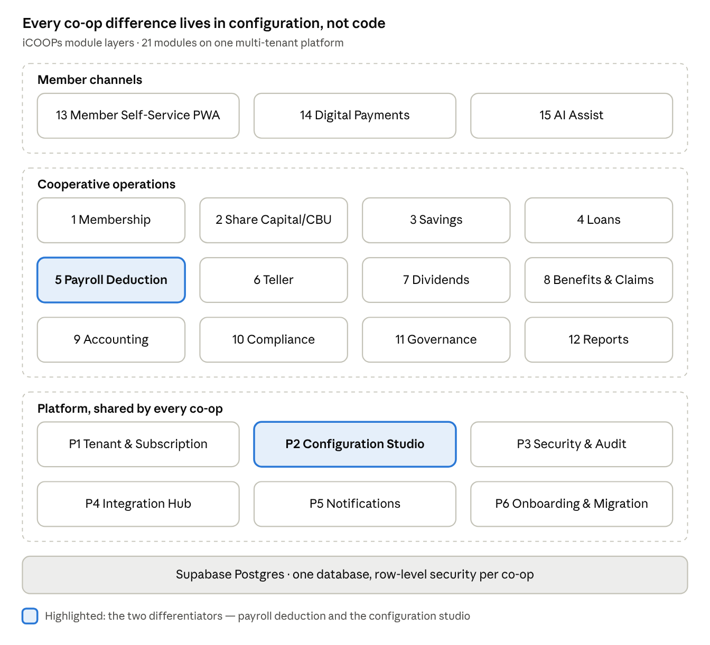

# iCOOPs Module and Feature Map

Oct 18, 2026 · @JunM

The new iCOOPs has 21 modules in three layers — a shared SaaS platform, cooperative operations, and member channels — with the payroll-deduction engine and a configuration studio as the two differentiators. Release tags: **R1** = MVP with the design partner, **R2** = repeatable product, **R3** = scale.

## At a glance

iCOOPs module layers · 21 modules

Channels sit on cooperative operations, which sit on a shared platform; a new co-op changes settings in the Configuration Studio, never the code.

## Module summary

Fifteen of the 21 modules start in R1, five of them in basic form; the rest wait until the design partner is live.

| \#  | Module                            | Purpose                                                                          | Release                    | Edition               |
|-----|-----------------------------------|----------------------------------------------------------------------------------|----------------------------|-----------------------|
| P1  | Tenant and Subscription Admin     | Provision co-ops, plans, billing, feature flags                                  | R1                         | Platform              |
| P2  | Configuration Studio              | Products, rules, formulas, forms, workflows and profile packs as tenant config   | R1                         | Platform              |
| P3  | Identity, Security and Audit      | Login, RBAC, approvals, 2FA, audit trail, data privacy                           | R1                         | Platform              |
| P4  | Integration Hub                   | APIs, file import/export, webhooks, partner connectors                           | R1 basic · R2 full         | Platform              |
| P5  | Notifications and Communications  | SMS, email, in-app alerts, announcements                                         | R1                         | Platform              |
| P6  | Onboarding and Migration Toolkit  | Load legacy members, balances and loans with reconciliation                      | R1                         | Platform              |
| 1   | Membership                        | Member lifecycle, KYC, beneficiaries, status                                     | R1                         | Core                  |
| 2   | Share Capital and CBU             | Subscriptions, paid-up capital, CBU plans, withdrawals, transfers                | R1                         | Core                  |
| 3   | Savings and Deposits              | Savings, time deposits, interest, holds, statements                              | R1                         | Core                  |
| 4   | Loans                             | Origination to closure: eligibility, approval, release, amortization, collection | R1                         | Core                  |
| 5   | Payroll Deduction and Collections | Deduction files per payroll office, remittance matching, shortfalls, allocation  | R1                         | Core — differentiator |
| 6   | Teller and Cashiering             | OR issuance, cash/cheque posting, cash count, end-of-day                         | R1                         | Core                  |
| 7   | Dividends and Patronage Refund    | Year-end computation, simulation, approval, allocation                           | R2                         | Core                  |
| 8   | Mutual Benefits and Claims        | Damayan, death, hospitalization, calamity benefits; insurer claims               | R2                         | Core                  |
| 9   | Accounting                        | Coop COA, automatic subledger-to-GL posting, FS, period close                    | R1 core · R2 full          | Core                  |
| 10  | Compliance and Regulatory         | CDA reports and COC, CIC/CISA, FCPAMS complaints, AMLA flags, BIR schedules      | R1 CDA basics · R2         | Core                  |
| 11  | Governance and Board              | Committees, resolutions, GA, elections, policy register                          | R2                         | Core                  |
| 12  | Reports and Analytics             | Standard reports, KPI dashboards, portfolio quality                              | R1 reports · R2 dashboards | Core                  |
| 13  | Member Self-Service (PWA)         | Balances, statements, loan apply, requests, documents                            | R2                         | Core · Member+ extras |
| 14  | Digital Payments                  | Pay loans and top up savings via licensed gateways and QR                        | R2                         | Member+               |
| 15  | AI Assist                         | Document check, loan pre-screen, member Q&A, anomaly flags                       | R2 OCR · R3                | Member+ / add-on      |

## Platform modules

The platform layer is what makes iCOOPs a product: every co-op difference lands in configuration here, never in code.

| Module                           | Submodule               | Key features                                                                                                                   |
|----------------------------------|-------------------------|--------------------------------------------------------------------------------------------------------------------------------|
| P1 Tenant and Subscription Admin | Tenant provisioning     | Create co-op, branches/units, fiscal year, currency, logo; sandbox tenant per prospect                                         |
|                                  | Plans and billing       | Tier by active members, add-ons, invoices, usage metering                                                                      |
|                                  | Feature flags           | Turn modules and profile packs on per tenant                                                                                   |
|                                  | Platform health         | Per-tenant usage, storage, job status, support access log                                                                      |
| P2 Configuration Studio          | Product builder         | Savings, loan, CBU and benefit products from templates: rates, terms, fees, penalties, limits                                  |
|                                  | Rules and formulas      | Interest (flat, diminishing, add-on), penalties, eligibility, dividend and patronage formulas — versioned with effective dates |
|                                  | Worked-example tester   | Run a formula against owner-approved examples before it goes live                                                              |
|                                  | Forms and fields        | Custom member fields, required documents, validation per tenant                                                                |
|                                  | Workflow designer       | Approval chains by amount, product and role (officer → manager → committee → board)                                            |
|                                  | Numbering and documents | Member no., account no., OR/voucher series, printable templates                                                                |
|                                  | Profile packs           | Install PNP-PSMB, DepEd, LGU or corporate packs (fields, deduction formats, reports)                                           |
| P3 Identity, Security and Audit  | Authentication          | Email/mobile login, 2FA/OTP, lockout, session timeout, SSO option for large tenants                                            |
|                                  | Roles and permissions   | Role templates (teller, loan officer, bookkeeper, manager, auditor, board), approval limits                                    |
|                                  | Maker-checker           | Dual control on money movement, backdating, overrides, rate changes                                                            |
|                                  | Audit trail             | Who, what, when, before/after values on every record; export for auditors                                                      |
|                                  | Data privacy            | Consent capture (RA 10173), data-subject requests, masking, retention rules                                                    |
| P4 Integration Hub               | Import / export         | CSV/Excel templates with validation and error reports                                                                          |
|                                  | APIs and webhooks       | JSON APIs per module; events (loan released, payment posted)                                                                   |
|                                  | Connectors              | Payment gateways, SMS, CIC submission, external ERP/accounting, bank files                                                     |
| P5 Notifications                 | Channels                | SMS, email, in-app, push (PWA)                                                                                                 |
|                                  | Triggers                | Due dates, payment received, approvals, maturities, birthdays, GA notices                                                      |
|                                  | Templates               | Bilingual (English/Filipino) message templates per tenant                                                                      |
| P6 Onboarding and Migration      | Data loaders            | Members, beneficiaries, share capital, savings, loans with schedules, opening GL                                               |
|                                  | Reconciliation          | Loaded balances vs legacy trial balance, exceptions list, sign-off                                                             |
|                                  | Parallel run            | Compare outputs with the old system for one cycle before cut-over                                                              |

## Membership and share capital

Membership is the master record every other module hangs on; share capital and CBU decide eligibility, voting and dividends.

| Module                  | Submodule                    | Key features                                                                                                      |
|-------------------------|------------------------------|-------------------------------------------------------------------------------------------------------------------|
| 1 Membership            | Application and onboarding   | Walk-in or online application, PMES attendance, requirements checklist, approval by Board/committee               |
|                         | Member profile               | Personal, contact, employment (employer, payroll office, unit), IDs, photo and signature                          |
|                         | Beneficiaries and dependents | Names, relationship, share %, contact; used by claims and benefits                                                |
|                         | Member type and status       | Regular/associate; active, inactive, suspended, resigned, deceased, terminated — with effective dates and reasons |
|                         | KYC and risk                 | ID verification, PEP/watchlist flag, risk rating for AMLA                                                         |
|                         | Membership card              | ID card with QR, reprint log                                                                                      |
|                         | Member 360 view              | One screen: capital, savings, loans, co-maker exposure, deductions, benefits, history                             |
|                         | Lifecycle events             | Transfer of unit/branch, retirement, resignation with clearance, death processing                                 |
| 2 Share Capital and CBU | Subscription                 | Subscribed vs paid-up shares, par value, minimum per by-laws                                                      |
|                         | CBU plans                    | Required monthly CBU by member type, auto-included in deductions                                                  |
|                         | Capital ledger               | Contributions, dividend-to-capital, transfers, withdrawals with running balance                                   |
|                         | Withdrawal and refund        | Resignation/death refunds, offset against loans, lock-in rules, Board approval for large amounts                  |
|                         | Share transfer               | Member-to-member with approval log                                                                                |
|                         | Certificates                 | Share certificate generation and register                                                                         |
|                         | Capital limits               | Max holding per member (CDA), alerts on breaches                                                                  |

## Savings and loans

Savings and loans carry most transactions and most risk, so every formula here is configured and tested, not coded per client.

| Module                 | Submodule                    | Key features                                                                                                                         |
|------------------------|------------------------------|--------------------------------------------------------------------------------------------------------------------------------------|
| 3 Savings and Deposits | Account opening              | Regular, special, youth, time deposit; multiple accounts per member                                                                  |
|                        | Transactions                 | Deposits, withdrawals, transfers, adjustments with maker-checker                                                                     |
|                        | Interest engine              | Daily/monthly balance methods, posting frequency, withholding tax                                                                    |
|                        | Time deposits                | Placement, certificate, maturity, rollover, pre-termination                                                                          |
|                        | Holds and status             | Legal hold, collateral hold, dormancy, closure workflow                                                                              |
|                        | Statements                   | Passbook print, digital statement, mini-statement                                                                                    |
| 4 Loans                | Loan products                | Regular, salary, emergency, multipurpose, calamity, housing, vehicle, appliance — from P2 templates                                  |
|                        | Application                  | Online or branch; auto-filled member data; required documents                                                                        |
|                        | Eligibility and capacity     | Capital and savings multiples, existing loans, net take-home-pay check, co-maker exposure                                            |
|                        | Credit evaluation            | Scoring weights, CI notes, CIC report attachment                                                                                     |
|                        | Approval                     | Workflow by amount and product; credit committee queue and minutes                                                                   |
|                        | Computation and release      | Amortization schedule, deductions at release (fees, insurance, doc stamps, CBU, prior loan payoff), check/cash/bank/e-wallet release |
|                        | Repayment                    | Allocation order (penalty → interest → principal, configurable), advance and partial payments                                        |
|                        | Renewal, restructure, top-up | With rules on minimum paid % and interest recomputation                                                                              |
|                        | Co-makers and collateral     | Co-maker limits, collateral register, release on full payment                                                                        |
|                        | Portfolio quality            | Aging buckets, past-due tagging, allowance for losses, demand letters                                                                |
|                        | Write-off and recovery       | Approval, recovery tracking                                                                                                          |

## Collections

The payroll-deduction engine is the module competitors lack; it turns a monthly reconciliation headache into a guided, auditable cycle.

| Module                              | Submodule                 | Key features                                                                                                              |
|-------------------------------------|---------------------------|---------------------------------------------------------------------------------------------------------------------------|
| 5 Payroll Deduction and Collections | Payroll offices           | Register each paying agency/employer (DepEd division, PNP finance unit, LGU, company HR) with its file format and cut-off |
|                                     | Deduction schedule        | Per member: CBU, savings, loan amortizations, benefit dues; start/stop dates                                              |
|                                     | Deduction file generation | Monthly file per payroll office in its required format; change lists (new, stop, amend)                                   |
|                                     | Take-home-pay check       | Flag deductions that breach net take-home-pay floors before submission                                                    |
|                                     | Remittance matching       | Import actual remittance; auto-match by member and item; partial and zero-pay handling                                    |
|                                     | Shortfall handling        | Unremitted list, carry-forward or direct-pay billing, member notification                                                 |
|                                     | Allocation rules          | Configurable order when remittance is short (e.g. loans before savings)                                                   |
|                                     | Agency reconciliation     | Expected vs received by agency and month; aging of unremitted amounts                                                     |
|                                     | Collector and direct pay  | Field collector routes and receipts for non-payroll members                                                               |
| 6 Teller and Cashiering             | Teller session            | Open/close, cash drawer limits, vault transfers                                                                           |
|                                     | Receipts                  | OR/AR issuance, bulk posting from one payment across multiple accounts                                                    |
|                                     | Disbursements             | Withdrawals, loan releases, refunds with vouchers                                                                         |
|                                     | Cash count and EOD        | Denomination count, over/short, end-of-day report, branch consolidation                                                   |
|                                     | Corrections               | Reversal with reason and approval, never deletion                                                                         |

## Year-end and benefits

Dividends and benefits are where members judge their co-op, so both run as simulated, approved, versioned computations.

| Module                           | Submodule                  | Key features                                                                               |
|----------------------------------|----------------------------|--------------------------------------------------------------------------------------------|
| 7 Dividends and Patronage Refund | Net surplus allocation     | Statutory reserves and funds per by-laws (reserve, education, CDF, optional funds)         |
|                                  | Interest on share capital  | Average share months method or configured method, rate from approved allocation            |
|                                  | Patronage refund           | Based on interest paid, purchases or other transactions, rate per service                  |
|                                  | Simulation                 | What-if rates, total payout, per-member preview before Board/GA approval                   |
|                                  | Approval and versioning    | Approved run locked; reruns create a new version with reason                               |
|                                  | Allocation                 | Credit to savings or capital, offset past-due loans, cash/check payout, unclaimed tracking |
|                                  | Member statements          | Per-member dividend and refund slip; tax treatment where applicable                        |
| 8 Mutual Benefits and Claims     | Benefit plans              | Damayan/mortuary, hospitalization, calamity, retirement gratuity; contribution rules       |
|                                  | Contributions              | Collected via deductions or teller; arrears tracking                                       |
|                                  | Claim filing               | By member or beneficiary, required documents per claim type                                |
|                                  | Validation and approval    | Eligibility check against status, contributions, beneficiaries; approval routing           |
|                                  | Payout                     | To beneficiary via cash, bank or e-wallet, with GL posting                                 |
|                                  | Insurer claims             | Track claims passed to partner insurers (e.g. CLIMBS, 1CISP) and their status              |
|                                  | Duplicate and fraud checks | Same incident, same beneficiary, deceased-member flags                                     |

## Accounting and compliance

Accounting moves inside the core, unlike the 2025 design, because co-ops buy on getting CDA financial statements without a second system.

| Module                       | Submodule                | Key features                                                                                         |
|------------------------------|--------------------------|------------------------------------------------------------------------------------------------------|
| 9 Accounting                 | Chart of accounts        | CDA-aligned coop COA template, branch/unit segments                                                  |
|                              | Auto-posting             | Every module transaction posts to GL through configurable posting rules; balanced-entry check        |
|                              | Journal vouchers         | Manual JVs with attachments and approval; recurring entries                                          |
|                              | Cash and bank            | Cash receipts and disbursement books, bank reconciliation by file upload                             |
|                              | Subledger reconciliation | Members' subledgers vs GL control accounts, daily exception list                                     |
|                              | Financial statements     | Trial balance, statement of financial condition, operations, cash flows, changes in equity           |
|                              | Period close             | Month lock, year-end closing, net surplus to allocation (feeds module 7)                             |
|                              | ERP export (R2)          | Push GL to an external ERP for co-ops that keep one                                                  |
| 10 Compliance and Regulatory | CDA reports              | Annual reports for Certificate of Compliance, social audit inputs, PEARLS-type ratios                |
|                              | Credit information       | CIC/CISA submission file from loan data                                                              |
|                              | Consumer protection      | FCPAMS complaints log: intake, SLA, resolution, reports                                              |
|                              | AMLA                     | Threshold and suspicious-transaction flags, review queue, report export                              |
|                              | Tax                      | BIR schedules and certificates the co-op needs (withholding on interest, dividends where applicable) |
|                              | Compliance calendar      | Deadlines, owners, reminders, submitted proof                                                        |
|                              | Policy register          | By-laws and policies with versions, linked to the rules they drive                                   |

## Member channels

Members get one installable web app (PWA) instead of native apps; money moves only through licensed payment providers, never an iCOOPs-held wallet.

| Module                       | Submodule                 | Key features                                                                         |
|------------------------------|---------------------------|--------------------------------------------------------------------------------------|
| 13 Member Self-Service (PWA) | Login                     | Member no. or mobile + OTP, device trust, PIN                                        |
|                              | Dashboard                 | Capital, savings, loans, next deductions, benefits at a glance                       |
|                              | Statements                | Download ledgers, loan schedules, dividend slips, certificates                       |
|                              | Loan self-service         | Loan calculator, apply, upload documents, track approval, co-maker consent           |
|                              | Requests                  | Withdrawal, profile and beneficiary updates, certificates, complaints (feeds FCPAMS) |
|                              | Announcements             | GA notices, e-voting link (R3), advisories                                           |
|                              | Offline-friendly          | Cached views and queued requests for weak-signal areas                               |
| 14 Digital Payments          | Pay-in                    | Loan payments and savings top-up via InstaPay/PESONet, QR Ph and partner e-wallets   |
|                              | Pay-out                   | Loan proceeds and refunds to bank or e-wallet                                        |
|                              | Auto-posting              | Gateway callbacks post to the member's accounts and GL                               |
|                              | Settlement reconciliation | Gateway settlement vs posted payments                                                |
|                              | Member+ extras (later)    | Marketplace, rewards, community features from the EZ-COOPS lineage                   |

## Governance, analytics and AI

These modules serve the Board and management; AI stays an assistant that drafts and flags, with a person approving every decision.

| Module                   | Submodule                | Key features                                                                                                |
|--------------------------|--------------------------|-------------------------------------------------------------------------------------------------------------|
| 11 Governance and Board  | Committees               | Board, credit, audit, election, education committees; members and terms                                     |
|                          | Meetings and resolutions | Agenda, minutes, resolutions linked to the transactions they approve                                        |
|                          | General Assembly         | Attendance, quorum, notices, approvals of financials and allocation                                         |
|                          | Elections                | Candidate list, eligibility check, tally (e-voting in R3)                                                   |
| 12 Reports and Analytics | Standard reports         | Member lists, ledgers, aging, collections, deductions, cash position, daily transaction journal             |
|                          | Executive dashboard      | Membership growth, capital, deposits, loans released and outstanding, past-due ratio, collection efficiency |
|                          | Portfolio quality        | Aging by product, unit and payroll office; top exposures                                                    |
|                          | Report builder           | Filter, group, schedule and email; export to Excel/PDF                                                      |
|                          | Federation roll-up (R3)  | Consolidated view across member co-ops for secondary co-ops                                                 |
| 15 AI Assist             | Document check           | Read IDs, payslips and claim documents; flag missing or mismatched data                                     |
|                          | Loan pre-screen          | Summarize capacity and history for the loan officer; no auto-approval                                       |
|                          | Member assistant         | Answer balance and policy questions in English or Filipino from the member's own data                       |
|                          | Anomaly flags            | Unusual withdrawals, duplicate claims, deduction mismatches                                                 |
|                          | Report narration         | Plain-language monthly summary for the Board                                                                |

## Profile packs and onboarding

Profile packs are how one codebase serves very different co-ops: each pack is configuration installed through the Configuration Studio, not a fork.

| Pack                   | Adds                                                                                                        | First likely buyer                  |
|------------------------|-------------------------------------------------------------------------------------------------------------|-------------------------------------|
| PNP / PSMB             | Rank, badge/serial, unit, assignment fields; PNP payroll deduction format; unit-level structure and reports | PSMB co-op group                    |
| DepEd teachers         | Division/school fields; APDS deduction file and service-fee handling; NTHP check                            | Teacher and DepEd employee co-ops   |
| LGU and GOCC employees | Office/department fields; LGU payroll formats                                                               | Provincial and city employee co-ops |
| Corporate employee     | Employer HR file formats, payroll cut-offs, separation clearance                                            | Company employee co-ops             |
| Community credit (R3)  | Collector routes, branch lending, OTC-heavy flows                                                           | MPCs outside payroll channels       |

Onboarding a new co-op follows one repeatable path: sandbox tenant → install pack → configure products and rules → test worked examples → migrate data → reconcile → one-month parallel run → go live. Target: under 6 weeks per co-op.

## Boundaries

Keeping these out protects the R1 timeline and avoids regulated activities iThink is not licensed for.

- **No stored-value e-wallet** — payments go through licensed providers (BSP EMI rules apply to co-ops).

- **No HRIS or staff payroll** — integrate with the co-op's HR system if needed.

- **No full document management system** — attachments live with records; DRMS integration is optional.

- **No native mobile apps** until PWA usage proves demand.

- **No client-specific code** — a request that config or a pack can't meet becomes a roadmap item or is declined.

Open questions for Jun: confirm the R1 cut with the design partner, which profile pack comes first, and whether accounting-inside-core is acceptable to co-ops that already run an ERP.
