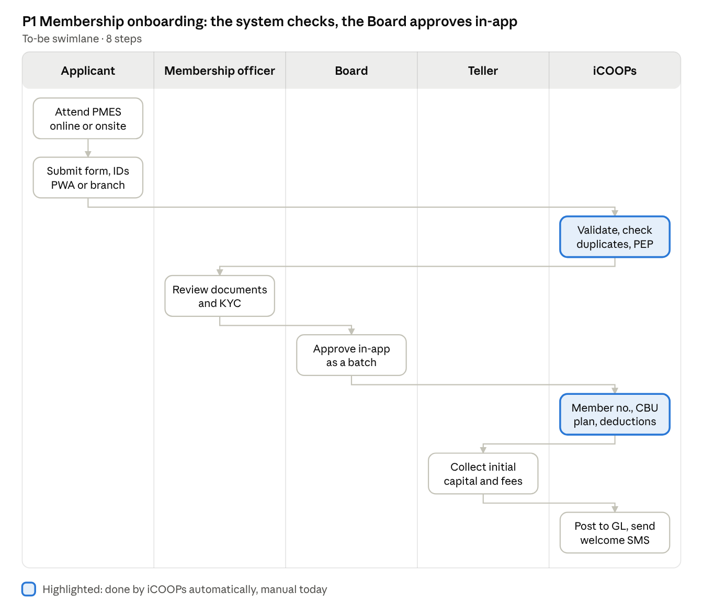
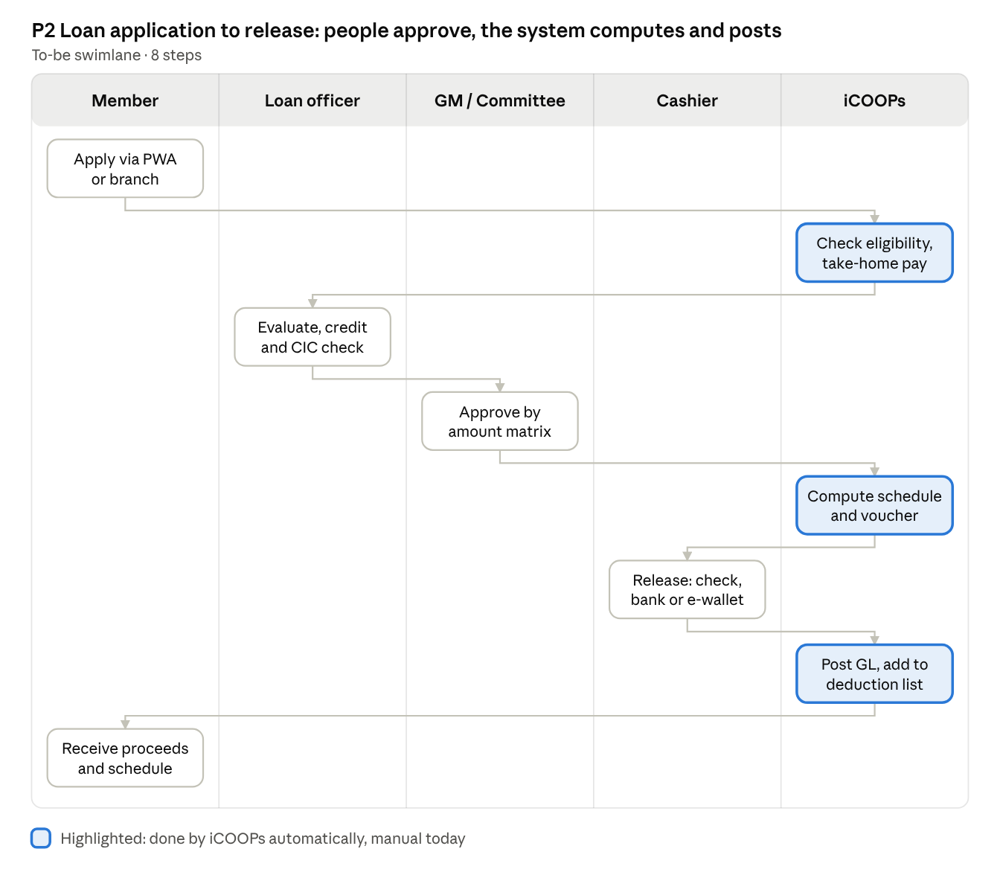
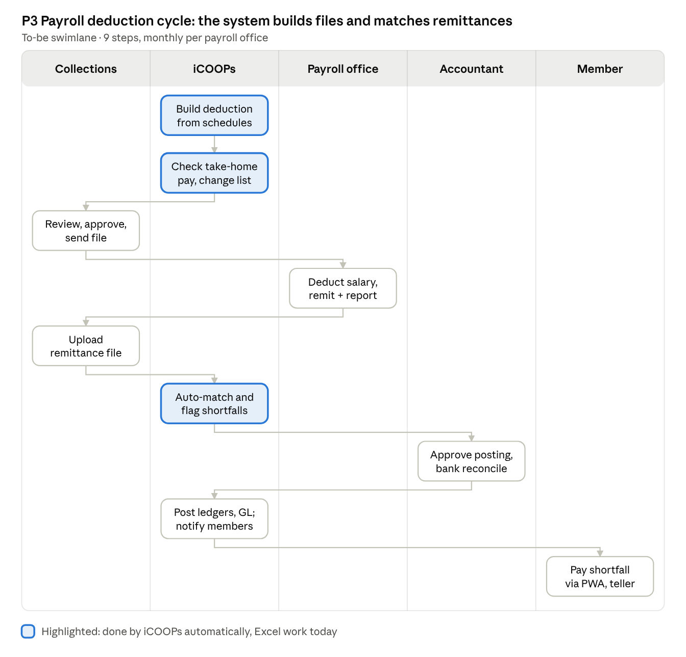
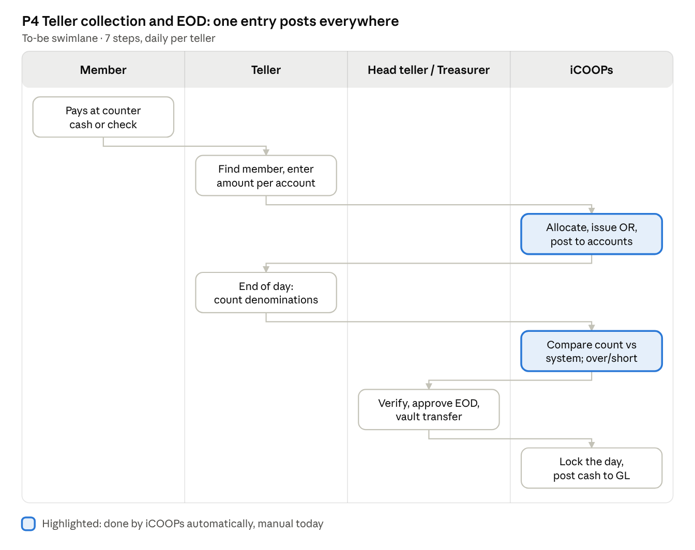
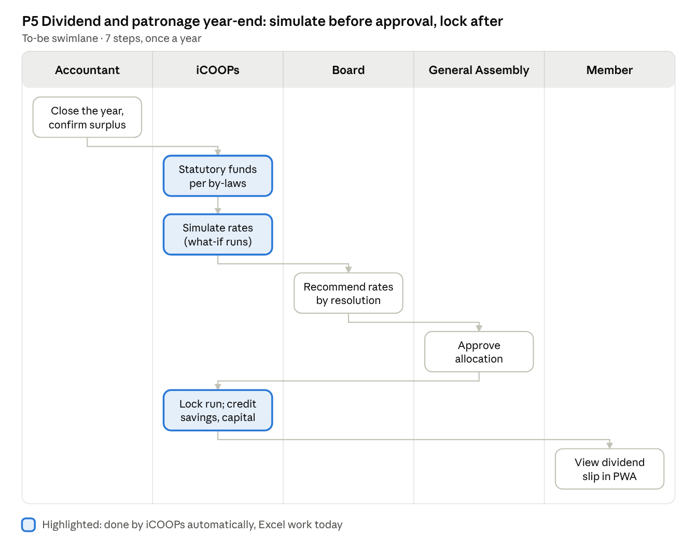
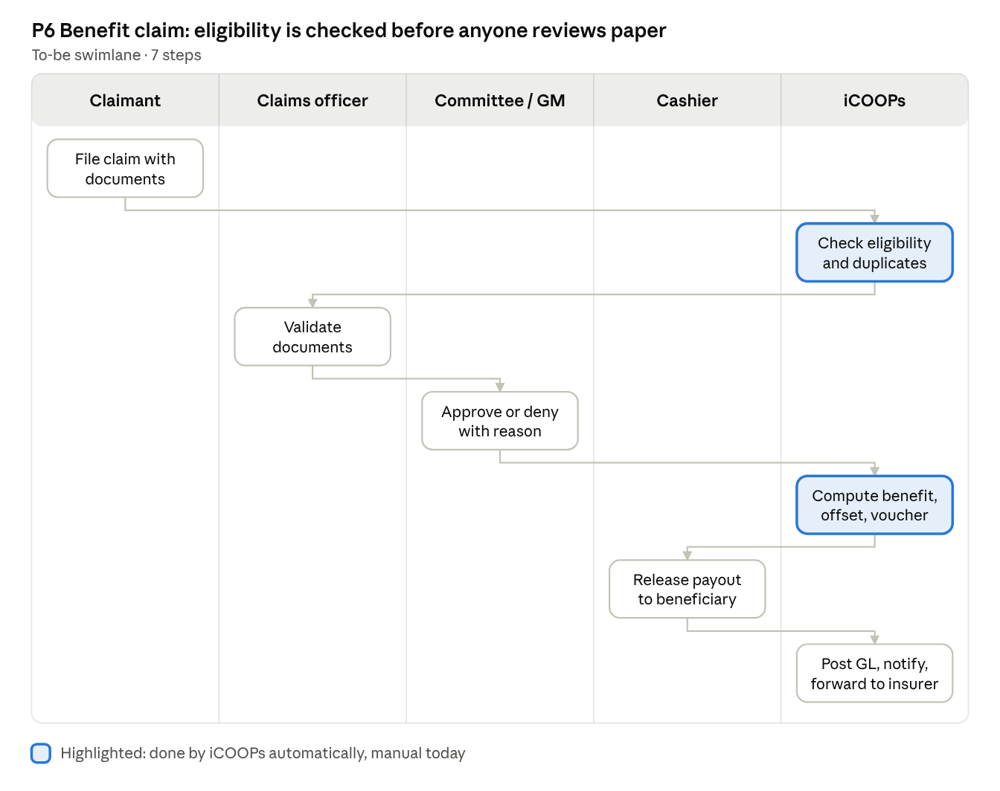
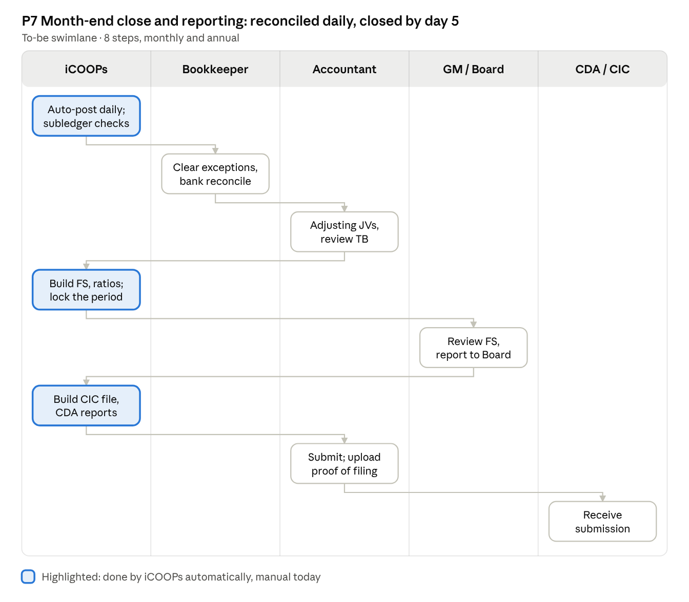

# iCOOPs BPR, SRS and Functional Specification

Oct 18, 2026 · @JunM

This tab redesigns the seven core cooperative processes around one rule: the system computes, matches and posts, and people review and approve. The SRS tab states what iCOOPs shall do; the Functional Spec tab details the R1 modules for the build.

## Document control and scope

Version 0.1 is a working draft for iThink review and design-partner validation; nothing here is owner-approved yet.

| Item            | Value                                                                                                            |
|-----------------|------------------------------------------------------------------------------------------------------------------|
| Product         | iCOOPs — multi-tenant cooperative management SaaS                                                                |
| Version         | 0.1 draft                                                                                                        |
| Owner           | iThink Digital (product owner: Jun Mercader)                                                                     |
| Audience        | iThink product and engineering, design-partner co-op management, auditors                                        |
| Baseline inputs | iCOOPs Module and Feature Map, SaaS Business Case, July 2025 core design (DRV-018), 2024 MMIS proposal (DRV-049) |
| Target segment  | Payroll-deduction (employee-based) cooperatives first                                                            |
| Stack           | Next.js + React, Supabase PostgreSQL (row-level security), JSON APIs, Python for batch jobs, Vercel, GitHub      |

| Tab                  | Covers                                                                        | Depth                |
|----------------------|-------------------------------------------------------------------------------|----------------------|
| BPR and swimlanes    | Actors, as-is vs to-be, 7 core processes, KPIs                                | All core processes   |
| SRS                  | Functional requirements for all 21 modules, non-functional, integration, data | All releases (R1–R3) |
| Functional Spec (R1) | Architecture, data model, rules, formulas, posting, roles, reports, tests     | R1 modules only      |

Conventions: requirements use “shall”; IDs read MODULE-NNN (e.g. LN-012); priority is Must / Should / Could; all money in PHP, 2-decimal rounding half-up unless a product rule says otherwise.

## Actors and roles

Fourteen actors take part in the to-be processes; roles map to permission sets in the security model, and one person may hold several roles in a small co-op.

| Actor                                 | Type             | Main responsibilities in iCOOPs                                                         |
|---------------------------------------|------------------|-----------------------------------------------------------------------------------------|
| Applicant / Member                    | External user    | Applies, views accounts, requests loans and withdrawals, files claims via PWA or branch |
| Beneficiary / Claimant                | External user    | Files benefit claims for a deceased or incapacitated member                             |
| Membership Officer                    | Co-op staff      | Reviews applications, KYC, maintains member records                                     |
| Loan Officer                          | Co-op staff      | Evaluates loans, credit investigation, prepares recommendations                         |
| Credit Committee                      | Governance       | Approves loans above officer limits                                                     |
| Collections Officer                   | Co-op staff      | Runs payroll deduction cycle, follows up shortfalls                                     |
| Teller / Cashier                      | Co-op staff      | Receives payments, issues ORs, releases cash and checks                                 |
| Treasurer / Head Teller               | Co-op officer    | Approves EOD, vault, disbursements                                                      |
| Bookkeeper / Accountant               | Co-op staff      | JVs, reconciliations, period close, statutory reports                                   |
| General Manager                       | Co-op management | Approvals within limits, oversight, Board reporting                                     |
| Board of Directors / General Assembly | Governance       | Membership approval, policies, dividend allocation                                      |
| Payroll Office                        | External agency  | Deducts from salary and remits (DepEd division, PNP finance, LGU, company HR)           |
| Regulators and partners               | External         | CDA, CIC, BIR, insurers, payment gateways                                               |
| iCOOPs (system)                       | System           | Validates, computes, matches, posts, notifies, logs                                     |

## BPR summary

Segment applicability: P3 (payroll deduction cycle) applies to segment S2 and is released in R2. For segment S1, monthly collection runs through P4 (teller and direct payments) plus loan follow-up.

Across all seven processes the redesign removes re-keying and spreadsheet reconciliation; targets are proposals to baseline with the design partner.

| \#  | Process                         | As-is (typical)                                                                                                | To-be redesign                                                                                                                                                | Target                                                              |
|-----|---------------------------------|----------------------------------------------------------------------------------------------------------------|---------------------------------------------------------------------------------------------------------------------------------------------------------------|---------------------------------------------------------------------|
| P1  | Membership onboarding           | Paper forms, manual ledger card, member no. assigned by hand, approval waits for next Board meeting            | Online or branch application, automatic duplicate and watchlist check, Board approves a batch in-app, CBU and deduction schedule created on approval          | Application to active member in ≤ 5 working days                    |
| P2  | Loan application to release     | Paper application, manual eligibility check against ledgers, Excel amortization, separate voucher and GL entry | System checks eligibility and take-home pay, computes schedule and release deductions, routes approvals by amount, posts GL and deduction schedule on release | Complete application to release in ≤ 2 working days (regular loans) |
| P3  | Payroll deduction cycle         | Deduction list rebuilt in Excel monthly; remittance matched line by line; shortfalls missed                    | Deduction file generated from schedules; remittance file auto-matched; shortfalls flagged and billed                                                          | Matching effort cut by ≥ 80%; unexplained variance = 0 at month-end |
| P4  | Teller collection and EOD       | Handwritten or Excel receipts, end-of-day tally by hand, posting next day                                      | Receipt posts to member accounts and GL at once; system-guided cash count; supervisor sign-off locks the day                                                  | EOD closed within 30 minutes of cut-off                             |
| P5  | Dividend and patronage year-end | Weeks of Excel work, formula errors, disputes                                                                  | Statutory allocation and per-member computation in-app, what-if simulation, locked approved run, automatic crediting                                          | Computation in 1 day; zero recomputation after GA                   |
| P6  | Benefit claim                   | Paper claim, manual check of contributions and beneficiaries, slow payout                                      | Online filing, automatic eligibility and duplicate check, offset of loans, voucher and GL in one flow                                                         | Complete claim to payout in ≤ 5 working days                        |
| P7  | Month-end close and reporting   | Subledgers reconciled to GL by hand, FS in Excel, CDA/CIC reports prepared separately                          | Daily auto-posting and subledger checks; FS, ratios and CIC file generated; period locked                                                                     | Close by working day 5; CDA reports in 1 day                        |

## P1 Membership onboarding

P1 Membership onboarding · 5 lanes, 8 steps

A rejection at document review or Board approval returns the application with a reason and notifies the applicant; payroll-deduction members can pay initial capital through their first deduction instead of at the teller.

## P2 Loan application to release

P2 Loan application to release · 5 lanes, 8 steps

Approval routing follows the tenant's amount matrix (e.g. officer, then GM, then credit committee); a disapproval or missing document returns the application to the member with a reason, and co-makers confirm in the PWA before evaluation.

## P3 Payroll deduction cycle

P3 Payroll deduction cycle · 5 lanes, 9 steps

The cycle runs once per payroll office per month; unmatched remittance lines go to an exceptions queue for the collections officer, and shortfalls follow the tenant's allocation order before any member is billed.

## P4 Teller collection and end-of-day

P4 Teller collection and end-of-day · 4 lanes, 7 steps

Corrections after posting are reversals with a reason and supervisor approval, never deletions; once the day is locked, back-dated entries need a manager override that is logged.

## P5 Dividend and patronage year-end

P5 Dividend and patronage year-end · 5 lanes, 7 steps

The locked run is the single source for crediting, past-due offsets, unclaimed tracking and member slips; a change after GA approval creates a new version with the reason and approver recorded.

## P6 Benefit claim

P6 Benefit claim · 5 lanes, 7 steps

Insured benefits (e.g. through CLIMBS or 1CISP) follow the same intake, then move to the insurer with status tracked in iCOOPs; the co-op's own damayan fund pays out directly.

## P7 Month-end close and regulatory reporting

P7 Month-end close and regulatory reporting · 5 lanes, 8 steps

The CIC file runs monthly; CDA annual reports run once a year from the locked year-end; a locked period reopens only by manager override with a logged reason.

## Process KPIs

Each KPI is captured by iCOOPs automatically from timestamps and postings, so the redesign can be proven, not claimed; baselines are measured at the design partner during the parallel run.

| KPI                                   | Process | How measured                     | Baseline | Target               |
|---------------------------------------|---------|----------------------------------|----------|----------------------|
| Application-to-activation time        | P1      | Submitted → status Active        | Measure  | ≤ 5 working days     |
| Loan turnaround time                  | P2      | Complete application → released  | Measure  | ≤ 2 working days     |
| Loans released with full document set | P2      | Checklist complete at release    | Measure  | 100%                 |
| Remittance auto-match rate            | P3      | Auto-matched lines ÷ total lines | Measure  | ≥ 95%                |
| Unremitted deductions over 60 days    | P3      | Aging of shortfalls              | Measure  | Down 50% in 6 months |
| Collection efficiency                 | P3, P4  | Collected ÷ due in the month     | Measure  | ≥ 95%                |
| EOD close time                        | P4      | Cut-off → EOD approved           | Measure  | ≤ 30 minutes         |
| Teller over/short incidents           | P4      | Count per month                  | Measure  | Down 50%             |
| Dividend computation effort           | P5      | Run start → approved run         | Measure  | 1 working day        |
| Claim turnaround                      | P6      | Filed → paid                     | Measure  | ≤ 5 working days     |
| Month-end close day                   | P7      | Period locked date               | Measure  | Working day 5        |
| Subledger-to-GL differences           | P7      | Exceptions at close              | Measure  | 0                    |
