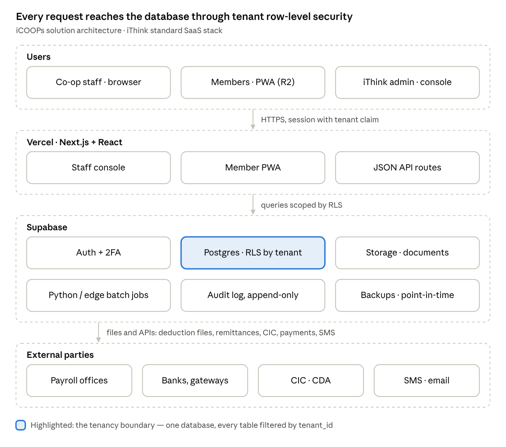

# Functional Specification (R1)

This tab specifies how the R1 modules work — data, rules, computations, statuses and screens — detailed enough to build and test against.

## Solution architecture

iCOOPs solution architecture · 4 layers

All tenants share one codebase and one Supabase project; isolation is enforced in the database by row-level security on tenant_id, so an application bug cannot leak another co-op's data. Large or government tenants can get a dedicated Supabase project with the same code (R2).

## Segments and feature flags

Every tenant has a segment that sets its default profile pack and flags; no code differs between segments (D14).

| Segment | Payroll deduction flag | Tenant shape | R1 status |
|---|---|---|---|
| S1 Private | OFF (may be switched ON per tenant) | One tenant per co-op | Built in R1 (PARTNER-S1) |
| S2 LGU / government | ON | One tenant, several payroll offices | Payroll deduction released in R2 |
| S3 Federation | Per member co-op | Parent tenant plus child tenants (tenant.parent_tenant_id) | Schema in R1, features in R3 |

## Core data model

About 30 core tables carry R1; every one has tenant_id under row-level security, and money never changes without a transaction row and a journal entry.

| Area          | Entity (table)                                  | Key fields                                                                                                                                          | Notes                                    |
|---------------|-------------------------------------------------|-----------------------------------------------------------------------------------------------------------------------------------------------------|------------------------------------------|
| Platform      | tenant                                          | id, name, cda_reg_no, fiscal_year_start, plan, status, segment, parent_tenant_id, features (JSON flags)                                                                                               | One row per cooperative                  |
|               | branch_unit                                     | id, tenant_id, code, name, parent_id                                                                                                                | Branches or PNP units                    |
|               | app_user, role, user_role                       | user, roles, approval limits                                                                                                                        | Staff accounts                           |
|               | audit_log                                       | actor, action, entity, entity_id, before, after, at                                                                                                 | Append-only                              |
| Configuration | product                                         | id, type (savings/loan/cbu/benefit), code, name, status                                                                                             | Product shell                            |
|               | rule_version                                    | product_id, rule_type, params (JSON), effective_from, approved_by                                                                                   | Rates, methods, fees, limits             |
|               | worked_example                                  | rule_version_id, inputs, expected_outputs, last_result                                                                                              | Blocks activation if failing             |
|               | approval_matrix                                 | txn_type, product_id, min_amt, max_amt, role_sequence                                                                                               | Approval routing                         |
| Members       | member                                          | id, member_no, type, status, names, birthdate, sex, civil_status, tin, gov_ids, employer, payroll_office_id, employee_no, branch_unit_id, join_date | Custom fields in custom_fields JSON      |
|               | beneficiary                                     | member_id, name, relationship, birthdate, share_pct                                                                                                 | Total 100%                               |
|               | member_document                                 | member_id, doc_type, file_ref, verified_by                                                                                                          | Files in Supabase storage                |
| Accounts      | account                                         | id, member_id, product_id, account_no, type, status, opened_on, balance                                                                             | Savings, CBU/share capital, time deposit |
|               | loan                                            | id, member_id, product_id, loan_no, principal, rate, method, term, status, released_on, maturity_on                                                 | Header                                   |
|               | loan_schedule                                   | loan_id, seq, due_date, principal, interest, balance                                                                                                | Generated at release                     |
|               | loan_comaker                                    | loan_id, member_id, exposure_amt, consent_at                                                                                                        | Co-maker limits                          |
| Transactions  | txn                                             | id, txn_no, date, type, channel, member_id, total, status, reversed_by                                                                              | One business event                       |
|               | txn_line                                        | txn_id, account_id or loan_id, component (principal/interest/penalty/deposit…), amount                                                              | Allocation detail                        |
|               | receipt                                         | or_no, txn_id, teller_session_id                                                                                                                    | Official receipt                         |
| Collections   | payroll_office                                  | id, name, format_code, cutoff_day, remit_account                                                                                                    | Paying agency                            |
|               | deduction_item                                  | member_id, payroll_office_id, item_type, ref_id, amount, start, stop                                                                                | The schedule                             |
|               | deduction_batch / remittance_line               | batch per office per month; lines with match_status                                                                                                 | P3 cycle                                 |
|               | teller_session                                  | teller_id, date, opening_cash, closing_count, over_short, approved_by                                                                               | P4 cycle                                 |
| Accounting    | gl_account, journal_entry, journal_line, period | COA, entries, lines, period status                                                                                                                  | Posted from txn via posting rules        |
| Compliance    | complaint                                       | member_id, category, received_at, sla_due, status, resolution                                                                                       | FCPAMS log                               |

## Configuration Studio

**Standard:** all rules follow `docs/08_Configurability_and_Library_Standard.md` (tiers T0 to T3, parameter precedence, parameter-based libraries). The rule types below are the starting inventory; the full parameter list, including calculation conventions, capital, membership, status guards, security and follow-up parameters, is in docs/08 section 5. Fixed numbers quoted elsewhere in this spec (365, 30, 15 minutes, 10%) are defaults.

Every rate, method and limit is a versioned rule tested against worked examples before activation — this is the mechanism that stops per-client code.

**Rule types and parameters (R1)**

| Rule type          | Applies to                 | Parameters                                                                                                        |
|--------------------|----------------------------|-------------------------------------------------------------------------------------------------------------------|
| Interest — savings | Savings, time deposit      | Annual rate, balance method (ADB, minimum monthly), posting frequency, minimum balance to earn, withholding tax % |
| Interest — loan    | Loan                       | Annual rate, method (diminishing, flat, add-on), compounding none, day-count (30/360 or actual/365)               |
| Term and amount    | Loan                       | Min/max term, min/max amount, multiple of capital and savings                                                     |
| Release deductions | Loan                       | List of items: service fee %, insurance rate, DST rule, CBU %, prior-loan payoff flag                             |
| Penalty            | Loan                       | Rate per month on past-due amount, grace days, cap                                                                |
| Allocation order   | Loan payments, remittances | Ordered list, e.g. penalty → interest → principal → CBU → savings                                                 |
| Eligibility        | Loan, membership           | Minimum membership months, max past-due days, co-maker count and exposure limit, NTHP floor                       |
| CBU plan           | Member type                | Required monthly amount or % of salary, minimum paid-up, lock-in months                                           |
| Approval matrix    | Any transaction type       | Amount bands → role sequence                                                                                      |

**Lifecycle of a rule version**

1.  Draft created by a configurator role, with effective-from date.

2.  Worked examples attached (at least three per rule: normal, boundary, exception).

3.  System runs the examples; any mismatch blocks submission.

4.  Approver (GM or Board-delegated) activates; earlier version stays for historical transactions.

5.  Transactions always use the version in force on their transaction date; back-dated postings use the old version.

Screens: Product list · Product editor (tabs: general, rules, documents, GL mapping) · Rule tester · Approval matrix editor · Numbering patterns · Custom fields · Profile pack installer (R2).

## Membership and share capital

A member moves through eight statuses; only an Active member can transact, borrow or be a co-maker.

| From status       | Event                              | To status  | Who                  | Rule                                                               |
|-------------------|------------------------------------|------------|----------------------|--------------------------------------------------------------------|
| —                 | Application submitted              | Applicant  | Applicant or officer | PMES date and required documents present                           |
| Applicant         | Board approval                     | Active     | Board (batch)        | Duplicate and watchlist checks cleared; resolution no. recorded    |
| Applicant         | Rejection                          | Rejected   | Officer or Board     | Reason mandatory; applicant notified                               |
| Active            | No activity for configured months  | Inactive   | System (nightly)     | Inactive members cannot borrow until reactivated                   |
| Active            | Disciplinary action                | Suspended  | Board                | Blocks new loans and withdrawals except by approval                |
| Active / Inactive | Resignation or retirement approved | Resigned   | GM / Board           | Clearance: loans settled or offset, capital refunded after lock-in |
| Any               | Death recorded                     | Deceased   | Officer + approval   | Triggers benefit claim and capital refund to beneficiaries         |
| Any               | Expulsion                          | Terminated | Board                | Same clearance as resignation                                      |

Key rules:

- Member number is generated on approval from the tenant pattern (e.g. branch code + year + sequence) and never reused.

- Employment fields (payroll office, employee no.) are required for payroll-deduction members; a change of payroll office moves all active deduction items to the new office from the next cycle.

- Share capital: paid-up must reach the by-law minimum within the configured months; holdings above the cap (maximum holding % parameter; CDA rule, typically 10% of total paid-up) are blocked.

- Capital refund on exit = paid-up capital − outstanding obligations offset, paid after lock-in and, above a threshold, Board approval.

Screens: Application intake · Application review queue · Board approval batch · Member search · Member 360 · Member edit (maker-checker on key fields) · Beneficiaries · Status change · Exit clearance · Capital ledger.

## Savings

Savings interest is computed daily on balances and posted at the product's frequency, with withholding tax deducted at posting.

Average daily balance (ADB) method, for a posting period of D days:

\text{ADB} = \frac{1}{D}\sum\_{d=1}^{D} \text{EndOfDayBalance}\_d

\text{Interest} = \text{ADB} \times \frac{r}{B} \times D (B = day-count basis parameter, default 365), \qquad \text{Net interest} = \text{Interest} - \text{Interest} \times t\_{wh}

where r is the annual rate in force and t_wh the withholding tax rate from the product rule. Minimum monthly balance method replaces ADB with the lowest end-of-day balance in the period.

| Rule                    | Behaviour                                                                                                                    |
|-------------------------|------------------------------------------------------------------------------------------------------------------------------|
| Minimum balance to earn | No interest if ADB (or minimum balance) is below it                                                                          |
| Rounding                | Interest rounded to 2 decimals, half-up, per account per posting                                                             |
| Withdrawals             | Blocked below maintaining balance; above limit needs approval; holds reduce available balance                                |
| Dormancy                | Flag after configured months without member-initiated transactions; reactivation needs officer approval                      |
| Time deposit            | Interest at maturity at the placement rate; pre-termination uses the product's pre-termination rate; auto-rollover if chosen |
| Closure                 | Balance + accrued interest − fees paid out; account status Closed, never deleted                                             |

Screens: Open account · Account inquiry and ledger · Deposit / withdrawal (teller) · Holds · Interest posting run (preview, approve, post) · Time deposit placement and certificate · Statement print.

## Loans

A loan is computed once at release from the rule version in force, and every later payment is allocated against its schedule in the configured order.

**Statuses**

| Status                 | Entered when                                 | Next statuses                             |
|------------------------|----------------------------------------------|-------------------------------------------|
| Draft                  | Application started                          | Submitted, Cancelled                      |
| Submitted              | Complete with documents and co-maker consent | Under evaluation                          |
| Under evaluation       | Officer picks up; eligibility already passed | For approval, Returned                    |
| For approval           | Recommendation saved                         | Approved, Disapproved, Returned           |
| Approved               | Final approver in matrix signs               | Released, Cancelled                       |
| Active                 | Proceeds released; schedule created          | Past due, Paid, Renewed, Restructured     |
| Past due               | An installment unpaid after grace days       | Active (cured), Restructured, Written off |
| Paid                   | Balance zero                                 | — (closed)                                |
| Renewed / Restructured | Replaced by a new loan that pays it off      | — (closed)                                |
| Written off            | Board-approved write-off                     | Recoveries tracked                        |

**Computation by method** (P = principal, r = annual rate, n = number of monthly installments, i = r/12)

Diminishing balance (level amortization):

A = P \cdot \frac{i}{1-(1+i)^{-n}}, \qquad \text{Interest}\_k = B\_{k-1} \cdot i, \qquad \text{Principal}\_k = A - \text{Interest}\_k

Flat / add-on:

I = P \cdot r \cdot \frac{n}{12}, \qquad A = \frac{P + I}{n}

Interest deducted in advance (discounted): I as above is deducted from proceeds and A = P / n.

Net proceeds at release:

\text{Net proceeds} = P - \text{service fee} - \text{insurance} - \text{DST} - \text{CBU retention} - \text{prior-loan payoff} - \text{advance interest}

Penalty on a past-due installment, for days late beyond grace: past-due amount × monthly penalty rate × days late ÷ penalty day divisor (default 30), capped per product. DST and insurance follow the product rule; the cooperative's tax exemption status must be confirmed with its tax adviser.

**Payment allocation (default order, configurable):** penalties → interest due → principal due → advance principal. Overpayment beyond the loan goes to the member's savings unless the member chooses advance payment.

**Dues schedule and follow-up (S1, R1).** With payroll deduction off, each loan's installments form a dues schedule per member. The system sends reminders before the due date, lists overdue installments by aging bucket, and queues follow-up tasks for the collections officer, who records contacts and promises to pay against the loan. Payments arrive through the teller or as recorded direct payments (bank deposit or transfer reference matched to the member's dues) and are allocated in the configured order.

**Loan disclosure statement (LN-019).** At release the system prints and stores a statement with principal, finance charges, each deduction, net proceeds, the installment amount and the effective interest rate, computed by the same loan library from the schedule. The member signs a copy.

Screens: Loan calculator · Application · Eligibility result · Evaluation · Approval queue · Release (computation preview, voucher) · Loan inquiry and schedule · Payment posting · Renewal / restructure · Aging report.

## Payroll deduction

**Release R2 (segment S2).** Built behind the `payroll_deduction` flag, which is OFF for S1 tenants; this section is retained as the design for the S2 release.

One deduction batch per payroll office per month carries the whole cycle: build, approve, send, receive, match, allocate, post.

**Batch statuses:** Building → For review → Approved → Sent → Remittance received → Matched → Posted → Closed.

**File generation**

1.  Select active deduction items for members of the office whose start date ≤ period and stop date is empty or ≥ period.

2.  Sum per member per item code required by the office format (some offices take one total, others separate codes per item).

3.  Compare with last month's batch to produce the change list: new, stopped, amended amount.

4.  Run the take-home-pay check where salary data is available: flag members whose total would leave net pay below the office floor; officer chooses to reduce, defer or keep.

5.  Render the file in the office's format code (fixed-width, CSV or Excel template) and lock the batch on approval.

**Remittance matching**

| Pass | Match key                                           | Result                                    |
|------|-----------------------------------------------------|-------------------------------------------|
| 1    | Employee no. + item code + amount equal to expected | Matched                                   |
| 2    | Employee no. + item code, amount lower              | Partial — allocate by order               |
| 3    | Employee no. found, item code missing or unknown    | Exception — officer assigns               |
| 4    | Name + birthdate when employee no. missing          | Suggested match — officer confirms        |
| —    | Expected line with no remittance                    | Zero-pay — shortfall                      |
| —    | Remittance line with no expected item               | Excess — to savings or refund, per policy |

Allocation of a member's partial remittance follows the tenant order (default: loan amortizations oldest-first → benefit dues → CBU → savings). Shortfalls become “unremitted” receivables per payroll office and are either carried into next month's file or billed to the member for direct payment. Service fees withheld by the office (e.g. DepEd's APDS fee) post to expense from the batch.

Screens: Payroll offices · Deduction schedule per member · Batch builder with change list · Take-home-pay exceptions · File download · Remittance upload · Match review and exceptions · Agency reconciliation · Unremitted aging.

## Teller and cashiering

Every teller transaction belongs to an open teller session, and the business date closes only when every session is approved.

| Rule                  | Behaviour                                                                       |
|-----------------------|---------------------------------------------------------------------------------|
| Session               | One open session per teller per business date; opening cash from vault transfer |
| Cash limit            | Above the teller's limit, the system prompts a vault transfer                   |
| Multi-account receipt | One payment split across loans, CBU, savings, benefit dues; one OR number       |
| OR numbering          | Pre-assigned series per teller; no gaps; cancelled ORs kept with reason         |
| Checks                | Recorded with bank and check no.; on-hold until cleared if product says so      |
| Disbursement          | Only against an approved voucher (loan release, withdrawal, refund, claim)      |
| Reversal              | Same-day reversal by supervisor; after day lock, manager override with reason   |
| End of day            | Denomination count; over/short posted to suspense with explanation              |
| Day lock              | All sessions approved → business date closes → next date opens                  |

Screens: Open session · Member payment (search, split, receipt) · Withdrawal / disbursement · Vault transfer · Cash count · EOD approval · Teller blotter report.

## Accounting posting rules

Each transaction type maps to a posting rule; the default R1 set is below, with GL account codes chosen per tenant in the product's GL mapping.

| Event                            | Debit                                | Credit                                                                                                                                                                             |
|----------------------------------|--------------------------------------|------------------------------------------------------------------------------------------------------------------------------------------------------------------------------------|
| Savings deposit (cash)           | Cash on hand                         | Savings deposits payable                                                                                                                                                           |
| Savings withdrawal               | Savings deposits payable             | Cash on hand                                                                                                                                                                       |
| Savings interest posting         | Interest expense on deposits         | Savings deposits payable; withholding tax payable                                                                                                                                  |
| Share capital / CBU contribution | Cash on hand (or payroll receivable) | Paid-up share capital                                                                                                                                                              |
| Loan release                     | Loans receivable (gross)             | Cash / bank; service fee income; insurance payable; DST payable; paid-up share capital (CBU retention); loans receivable (prior-loan payoff); unearned interest (advance interest) |
| Loan payment                     | Cash or payroll receivable           | Loans receivable; interest income; penalty income                                                                                                                                  |
| Payroll deduction batch approved | Payroll receivable — \[office\]      | Clearing — deductions in transit                                                                                                                                                   |
| Remittance received              | Cash in bank; service fee expense    | Payroll receivable — \[office\]                                                                                                                                                    |
| Allocation of remittance         | Clearing — deductions in transit     | Loans receivable; interest income; share capital; savings deposits payable                                                                                                         |
| Teller overage / shortage        | Cash on hand / Suspense              | Suspense / Cash on hand                                                                                                                                                            |
| Allowance for probable losses    | Provision for losses                 | Allowance for probable losses                                                                                                                                                      |

Unremitted shortfalls are written back from the clearing account to the payroll receivable and then either rolled into next month's batch or reclassified to a member receivable when billed for direct payment.

Every journal entry stores its source transaction ID; journal lines are never edited, only reversed.

## Security: roles and permissions

Default role templates enforce segregation of duties: no one who creates a money movement can approve it. Tenants may adjust limits but not remove maker-checker on money movement.

Key: C = create/edit · A = approve · V = view · — = no access

| Function                        | Teller      | Member. officer | Loan officer  | Collections | Bookkeeper | Accountant | GM                 | Board               | Auditor | Tenant admin |
|---------------------------------|-------------|-----------------|---------------|-------------|------------|------------|--------------------|---------------------|---------|--------------|
| Member record                   | V           | C               | V             | V           | V          | V          | A                  | V                   | V       | —            |
| Membership approval             | —           | C               | —             | —           | —          | —          | V                  | A                   | V       | —            |
| Deposit / payment posting       | C           | —               | —             | —           | —          | V          | V                  | —                   | V       | —            |
| Withdrawal above limit          | C           | —               | —             | —           | —          | —          | A                  | —                   | V       | —            |
| Loan application and evaluation | V           | —               | C             | —           | —          | —          | V                  | V                   | V       | —            |
| Loan approval                   | —           | —               | A (own limit) | —           | —          | —          | A (limit)          | A (committee)       | V       | —            |
| Loan release voucher            | C (release) | —               | C (prepare)   | —           | —          | A          | A                  | —                   | V       | —            |
| Teller EOD                      | C           | —               | —             | —           | —          | V          | A (or head teller) | —                   | V       | —            |
| Deduction batch and matching    | —           | —               | —             | C           | V          | A          | V                  | —                   | V       | —            |
| Journal voucher                 | —           | —               | —             | —           | C          | A          | V                  | —                   | V       | —            |
| Period close / reopen           | —           | —               | —             | —           | —          | C          | A                  | —                   | V       | —            |
| Product and rule configuration  | —           | —               | —             | —           | —          | C          | A                  | A (rates by policy) | V       | C            |
| Users and roles                 | —           | —               | —             | —           | —          | —          | A                  | —                   | V       | C            |
| Audit log                       | —           | —               | —             | —           | —          | V          | V                  | V                   | V       | V            |
| Reports and dashboard           | Own         | Own             | Own           | Own         | V          | V          | V                  | V                   | V       | —            |

Defaults: session timeout 15 minutes idle; 5 failed logins lock the account; OTP required for approvals and for any login from a new device. These are security-policy parameters, tenant-adjustable only within platform limits.

## R1 reports and compliance outputs

R1 ships 20 standard outputs; every one filters by branch/unit, payroll office and date, and exports to Excel and PDF.

| \#  | Report                                                           | Users                       | Frequency       |
|-----|------------------------------------------------------------------|-----------------------------|-----------------|
| 1   | Member masterlist and new/exited members                         | Membership officer, Board   | Monthly         |
| 2   | Member 360 / statement of account                                | Staff, member               | On demand       |
| 3   | Capital and CBU ledger and summary                               | Accountant, Board           | Monthly         |
| 4   | Savings ledger, balances and dormant accounts                    | Accountant                  | Daily / monthly |
| 5   | Interest posting register                                        | Accountant                  | Per run         |
| 6   | Loan releases register                                           | GM, Board                   | Daily / monthly |
| 7   | Loan portfolio and aging by product, unit, payroll office        | GM, Board, credit committee | Monthly         |
| 8   | Past-due list with co-makers                                     | Collections, GM             | Weekly          |
| 9   | Deduction batch and change list (S2)                                  | Collections                 | Monthly         |
| 10  | Remittance reconciliation by payroll office (S2)                      | Collections, Accountant     | Monthly         |
| 11  | Unremitted deductions aging (S2)                                      | Collections, GM             | Monthly         |
| 12  | Teller blotter and cash position                                 | Head teller                 | Daily           |
| 13  | OR register (issued and cancelled)                               | Accountant, auditor         | Daily           |
| 14  | Daily transaction journal                                        | Accountant, auditor         | Daily           |
| 15  | Trial balance and general ledger                                 | Accountant                  | Monthly         |
| 16  | Financial statements (condition, operations, cash flows, equity) | GM, Board                   | Monthly         |
| 17  | Subledger vs GL reconciliation                                   | Accountant                  | Daily           |
| 18  | CIC/CISA submission file                                         | Accountant                  | Monthly         |
| 19  | Complaints log and SLA report (FCPAMS)                           | GM, compliance              | Monthly         |
| 20  | Executive dashboard                                              | GM, Board                   | Live            |

## Acceptance test scenarios

R1 is accepted when these scenarios pass at the design partner on synthetic or approved de-identified data, during a one-month parallel run.

| ID    | Scenario                                                                                    | Expected result                                                                           | Traces to                  |
|-------|---------------------------------------------------------------------------------------------|-------------------------------------------------------------------------------------------|----------------------------|
| AT-01 | Onboard a payroll-deduction member through Board batch approval                             | Member no. generated; CBU plan and deduction items created; GL posted for initial capital | MB-001–007, SC-002, AC-002 |
| AT-02 | Duplicate applicant (same name, birthdate, ID)                                              | Flagged; cannot be approved without override reason                                       | MB-003                     |
| AT-03 | Release a diminishing-balance loan with fee, insurance, CBU retention and prior-loan payoff | Schedule and net proceeds equal the owner's worked example to the centavo; GL balanced    | LN-007, AC-002             |
| AT-04 (S2, R2) | Loan that breaches the take-home-pay floor                                                  | Blocked or warned per configuration; override needs GM approval                           | LN-004, PD-004             |
| AT-05 (S2, R2) | Monthly deduction file for one payroll office                                               | Totals equal the sum of active deduction items; change list correct vs prior month        | PD-003                     |
| AT-06 (S2, R2) | Remittance with partial, zero-pay, unknown and excess lines                                 | Each classified correctly; partials allocated in order; shortfalls listed                 | PD-005–008                 |
| AT-07 | Teller receipt split across loan, CBU and savings, then EOD with a shortage                 | One OR; three postings; shortage to suspense; day locks after approval                    | TL-002, TL-004, TL-005     |
| AT-08 | Reverse a posted payment after day lock                                                     | Requires manager override with reason; original and reversal both visible                 | TL-006, PL-022             |
| AT-09 | Savings interest run for a month                                                            | ADB, gross interest and withholding equal the worked example                              | SV-003                     |
| AT-10 | Change a loan rate effective next month                                                     | Old loans keep old rate; new loans after the date use the new version                     | PL-011                     |
| AT-11 | Month-end close                                                                             | Subledgers equal GL controls; FS generated; period locked                                 | AC-006–008                 |
| AT-12 | CIC file for the month                                                                      | File passes CIC format validation                                                         | CP-001                     |
| AT-13 | Tenant isolation                                                                            | A user of tenant A cannot read or write any row of tenant B through UI or API             | PL-001, NF-007             |
| AT-14 | Maker-checker                                                                               | Creator of a withdrawal above limit cannot approve it                                     | PL-022                     |
| AT-15 (S1) | Loan installment goes overdue with payroll deduction OFF | Reminder sent before due date; installment listed in the overdue queue; follow-up task created; contact and promise to pay recorded | LN-017, LN-018 |
| AT-17 (S1) | Release a loan and print the disclosure statement | Statement shows finance charges and effective interest rate equal to the worked example; copy stored with the loan | LN-019 |
| AT-16 (S1) | Member pays by bank deposit with a reference | Payment matched to the member's dues; allocated penalty, interest, principal; receipt issued | PD-012, LN-010 |

## Validation checklist for the first S1 customer

No design partner is signed (D18). The R1 build proceeds on the standard S1 profile in docs/10; these inputs validate or correct its parameter values during onboarding and the parallel run.

- [ ] (S2 only) Sample deduction files and remittance reports for each payroll office (de-identified)
- [ ] (S1) How members pay today (teller, bank deposit, other), the follow-up routine for overdue loans and loan-loss history

- [ ] Loan products with rates, methods, release deductions and penalties, plus three worked examples each

- [ ] Savings products and interest method, with worked examples

- [ ] By-laws: CBU minimums, capital cap, lock-in, net surplus allocation percentages

- [ ] Current chart of accounts and last audited financial statements

- [ ] Approval matrix and staff role list

- [ ] Tax-exemption status and DST treatment confirmed by the co-op's tax adviser

- [ ] Legacy data inventory: member count, open loans, data source and quality
